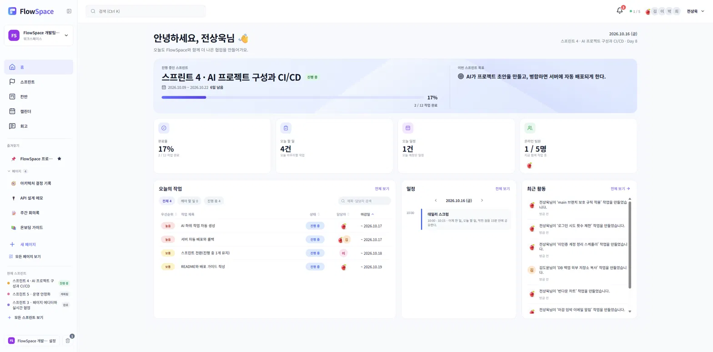
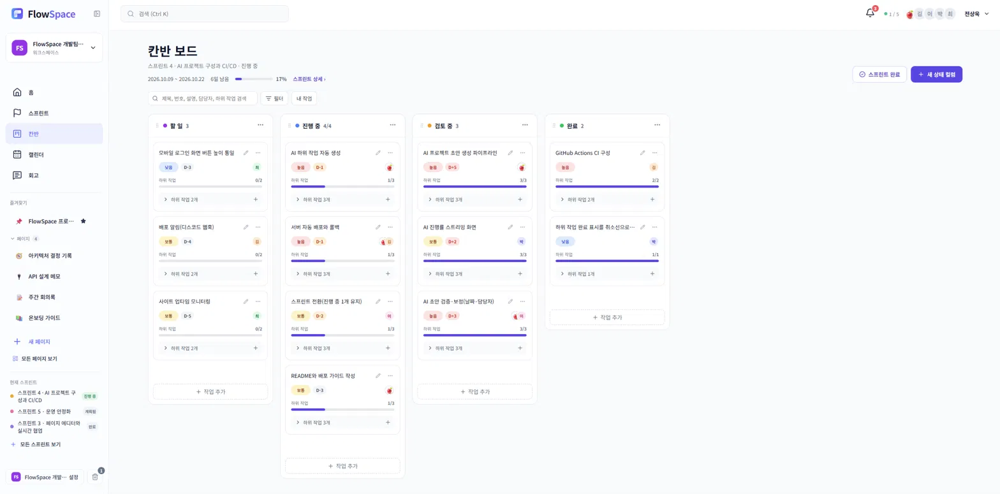
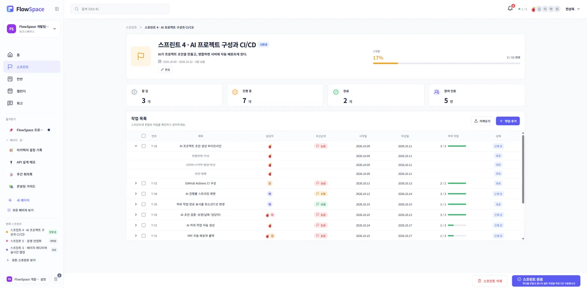
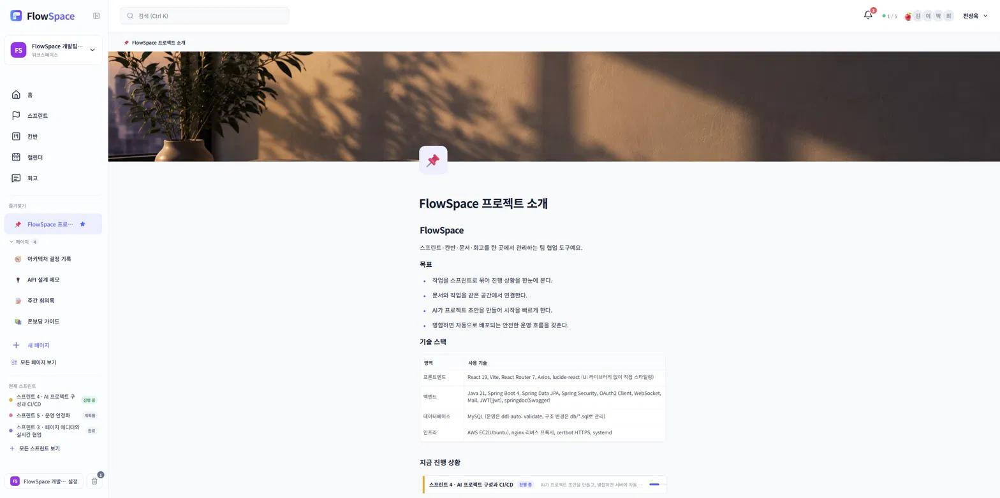
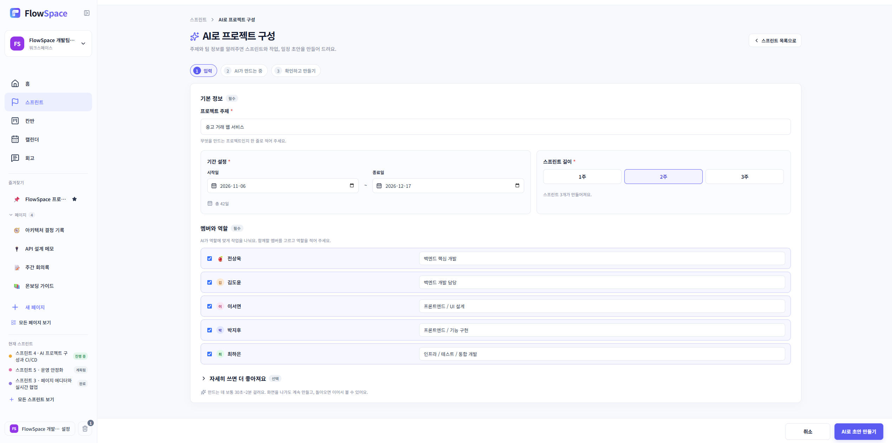
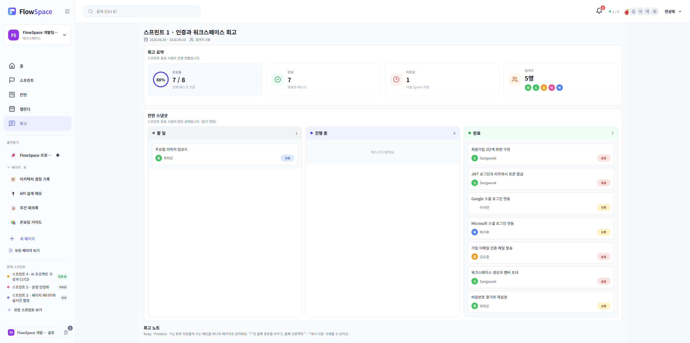

# FlowSpace

**스프린트·칸반·문서·회고를 한 곳에서 관리하는 팀 협업 도구**입니다.
AI가 프로젝트 주제만 받아 스프린트와 작업, 하위 작업까지 초안을 만들어 주고, 팀원이 같은 문서를 실시간으로 함께 보며 작업합니다.

🔗 **배포 주소: https://myflowspace.cloud**

| 대시보드 | 칸반 보드 |
| :---: | :---: |
|  |  |

| 스프린트 상세 | 페이지(블록 에디터) |
| :---: | :---: |
|  |  |

| AI 프로젝트 구성 | 회고 |
| :---: | :---: |
|  |  |

---

## 주요 기능

**프로젝트 관리**

- **워크스페이스**: 멤버 초대와 역할(소유자·관리자·멤버) 관리, 가입하면 개인 워크스페이스가 자동으로 만들어집니다.
- **스프린트**: 생성·시작·완료. 진행 중인 스프린트는 항상 하나만 유지하며, 다른 스프린트를 시작하면 기존 스프린트가 "계획됨"으로 돌아갑니다.
- **작업과 하위 작업**: 담당자(여러 명), 우선순위, 기간, 하위 작업 체크. 상태는 워크스페이스마다 자유롭게 만들고 WIP 제한을 둘 수 있습니다.
- **칸반 보드·캘린더**: 드래그로 상태를 옮기고, 일정과 스프린트를 달력에서 한눈에 봅니다.
- **회고**: 스프린트를 완료하면 그 시점의 작업 상태가 스냅샷으로 남고 회고 페이지가 자동으로 만들어지며, 끝나지 않은 작업은 백로그로 이동합니다.

**문서와 협업**

- **페이지(블록 에디터)**: 노션처럼 제목·할 일·토글·콜아웃·코드·이미지·파일·열 나누기·데이터베이스 블록을 조합해 문서를 만듭니다.
- **실시간 반영**: WebSocket으로 알림, 접속 상태, 다른 멤버의 변경이 즉시 반영됩니다. 동시 수정 충돌을 막기 위해 페이지에 버전을 둡니다.
- **댓글·멘션·활동 기록·검색·알림**: 마감 임박 알림은 한국 시간 기준으로 발송합니다.

**AI 프로젝트 구성**

- 주제, 기간, 멤버와 역할을 입력하면 AI가 스프린트·작업·하위 작업·일정 초안을 만듭니다. 사용자는 미리보기에서 고친 뒤 한 번에 만들 수 있습니다. (아래 [AI 기능](#ai-기능) 참고)

**계정과 보안**

- 이메일 가입(2단계) + **이메일 인증**, Google·Microsoft 소셜 로그인, 비밀번호 찾기.
- JWT 액세스/리프레시 토큰, 파일 업로드 형식 제한, 운영 환경에서는 Swagger 비공개.

---

## 기술 스택

| 영역         | 사용 기술                                                                                                               |
| ------------ | ----------------------------------------------------------------------------------------------------------------------- |
| 프론트엔드   | React 19, Vite, React Router 7, Axios, lucide-react (UI 라이브러리 없이 직접 스타일링)                                  |
| 백엔드       | Java 21, Spring Boot 4, Spring Data JPA, Spring Security, OAuth2 Client, WebSocket, Mail, JWT(jjwt), springdoc(Swagger) |
| 데이터베이스 | MySQL (운영은 `ddl-auto: validate`, 구조 변경은 `db/*.sql`로 관리)                                                      |
| AI           | Ollama + `qwen3.6:27b` (JSON 스키마 출력, 스트리밍)                                                                     |
| 인프라       | AWS EC2(Ubuntu), nginx 리버스 프록시, certbot HTTPS, systemd                                                            |
| CI/CD        | GitHub Actions (테스트 → 빌드 → 자동 배포·롤백)                                                                         |
| 테스트       | JUnit 5, Mockito — 단위 테스트 200개 이상                                                                               |

---

## 아키텍처

```
사용자 브라우저
     │ https
     ▼
nginx ─┬─ /                       → React 빌드 결과(정적 파일)
       └─ /api, /ws, /uploads     → Spring Boot (8080) ─→ MySQL
                                        │
                                        └─(AI 사용 시) SSH 리버스 터널 ─→ 내 PC의 Ollama
```

- 한 도메인으로 묶어 CORS 설정이 필요 없고 HTTPS 인증서도 하나로 충분합니다.
- 백엔드는 `Controller → Service → Repository` 계층에 DTO를 두는 구조이며, OAuth 처리는 `AuthService` 안에 모았습니다.
- 프론트는 Axios 공통 인스턴스와 `api/` 모듈, 화면 전체 상태는 React Context로 관리합니다.

---

## AI 기능

모델 응답을 그대로 쓰지 않고, **쓸 수 있는 초안이 되도록 서버가 검증하고 보정**합니다.

1. **프롬프트 구성**: 입력값을 정리해 모델에 전달하고, 응답은 JSON 스키마로 강제합니다.
2. **스트리밍 진행률**: 모델이 쓰는 글을 읽으며 만들어진 스프린트·작업 수로 진행률과 "방금 만든 작업"을 화면에 보여 줍니다.
3. **검증·보정**: 한자·일본어 섞임 제거, 조사 교정, 역할에 맞는 담당자 배정, 중요도 보정, 날짜 계산(주말·고정 일정 제외), 작업 간 선후관계 규칙 적용, 빠진 구간 채우기.
4. **하위 작업 생성**: 스프린트마다 모델을 한 번 더 호출해 작업별 하위 작업(2~4개)을 만들고, 실패하면 기본 항목으로 채워 최소 개수를 보장합니다.
5. **재시도·취소**: 쓸 수 없는 초안이면 최대 3번까지 다시 만들고, 사용자가 중간에 취소할 수 있습니다. 화면을 나가도 작업은 이어집니다.
6. **적용**: 사용자가 미리보기에서 고친 최종 초안을 서버가 다시 검증한 뒤 스프린트·작업·하위 작업·일정으로 한 번에 저장합니다.

> 서버에 GPU가 없어, 배포 환경에서는 **개발 PC의 Ollama를 SSH 리버스 터널로 연결**해 사용합니다. PC가 꺼져 있으면 "현재 이용할 수 없어요"로 안내합니다. 설정값 `flowspace.ai.enabled`로 기능 자체를 끌 수 있습니다.

---

## 배포와 운영 (CI/CD)

`main` 브랜치에 병합하면 GitHub Actions가 테스트·빌드부터 서버 반영까지 자동으로 처리합니다.

- **PR**: 백엔드 테스트·jar 빌드와 프론트 빌드를 검증합니다(배포 없음).
- **병합 후 자동 배포**: jar와 프론트를 서버로 올리고 교체합니다.
- **자동 롤백**: 새 버전이 켜지지 않으면(헬스체크 실패) 이전 jar로 되돌리고 배포를 실패 처리합니다.
- **최소 권한 SSH**: 서버의 22번 포트는 평소 닫혀 있고, 배포하는 동안만 실행기 IP에 열었다가 항상 닫습니다. 이 일을 하는 AWS 계정은 해당 보안 그룹 규칙 추가·삭제 권한만 가집니다.
- **백업**: DB와 업로드 폴더를 매일 새벽 백업합니다.

운영 절차, 장애 대응, 키 관리 방법은 [docs/DEPLOY_GUIDE.md](docs/DEPLOY_GUIDE.md)에 정리했습니다.

---

## 폴더 구조

```
flowspace/
├─ backend/                      Spring Boot
│  └─ src/main/java/com/flowspace/
│     ├─ controller/  service/  repository/  entity/  dto/
│     ├─ security/  websocket/  config/  exception/
│     └─ service/ai/             AI 초안 생성·검증·적용
│  └─ src/main/resources/db/     ddl.sql, alter_*.sql (DB 구조와 변경 이력)
├─ frontend/                     React + Vite
│  └─ src/  api/  components/  context/  hooks/  layout/  pages/  styles/  utils/
├─ deploy/                       서버 배포 스크립트, AI 터널 스크립트
├─ docs/                         배포·운영 가이드
└─ .github/workflows/ci-cd.yml   CI/CD
```

---

## 로컬에서 실행하기

### 준비물

JDK 21, Node.js(LTS), MySQL 8

### 1. 데이터베이스

```sql
-- MySQL에서 실행: flow_space DB와 모든 테이블이 만들어집니다.
source backend/src/main/resources/db/ddl.sql
```

### 2. 백엔드

`backend/src/main/resources/application-secret.yaml`(저장소에 포함되지 않음)을 만들어 DB 연결 정보, JWT 비밀키, Google/Microsoft 클라이언트 ID, 메일 계정을 넣습니다. 필요한 항목은 [docs/SERVER_SETUP_GUIDE.md](docs/SERVER_SETUP_GUIDE.md)의 환경 변수 목록을 참고하세요.

```bash
cd backend
./gradlew bootRun        # http://localhost:8080 (Swagger: /swagger-ui/index.html)
```

AI 기능을 쓰려면 [Ollama](https://ollama.com)를 설치하고 `qwen3.6:27b` 모델을 받아 둡니다. 쓰지 않으면 `flowspace.ai.enabled: false`로 끄면 됩니다.

### 3. 프론트엔드

```bash
cd frontend
cp .env.example .env.development   # VITE_API_BASE_URL 등을 채웁니다
npm install
npm run dev                        # http://localhost:5173
```

### 테스트

```bash
cd backend && ./gradlew test
cd frontend && npm run lint && npm run build
```

---

## 개발 규칙

- 백엔드: Service에 주석, Controller에 `@Operation(summary)`, DTO 패턴 유지.
- 프론트: 컴포넌트는 JSX, api·util은 JS, Axios 공통 인스턴스 사용.
- 브랜치 → Pull Request → CI 통과 → `main` 병합(자동 배포).
- 자세한 내용은 [PROJECT_RULE.md](PROJECT_RULE.md)를 참고하세요.

---

## 문서

- [배포·운영 가이드](docs/DEPLOY_GUIDE.md) — 구조, 배포 흐름, 장애 대응, 키 관리
- [서버 처음 구축 가이드](docs/SERVER_SETUP_GUIDE.md) — Ubuntu 서버를 처음부터 만드는 과정
